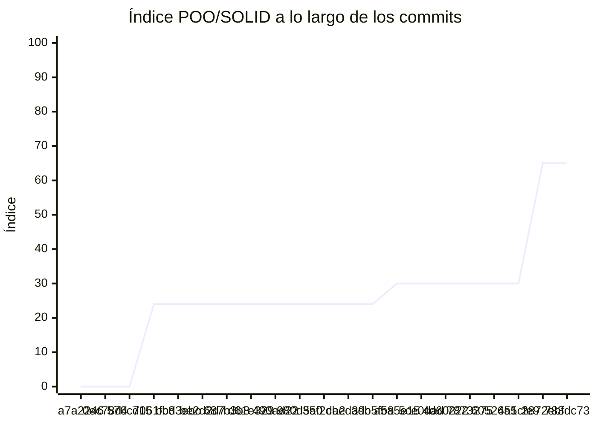

<!-- evaluacion:inicio -->
# Evaluación — Chiqui-Nero-Corp/Prueba-N-3

> Documento **generado automáticamente** por la cátedra de Programación II (RepoSense + análisis de calidad POO/SOLID). **No editar a mano**: se regenera en cada evaluación.
> Rama evaluada: `main`. Análisis **heurístico** (regex + métricas): es una criba para orientar la revisión, **no una nota**.
> Generado: 2026-11-27.

## 1. Veredicto

| Aspecto | Resultado |
|---|---|
| Índice de calidad POO/SOLID | **65/100** |
| Commit evaluado | `783dc73535f5` (2026-11-27) |
| Código (LOC) | 68 |
| Archivos de código | 3 |
| Clases (bien usadas) | 3 (3 OK) |
| Código dentro de clases (%POO) | 100% |
| Funciones fuera de clases | 0 |
| Duplicación lógica | 0.0% |
| Señales S/O/L/I/D | 0/0/0/0/0 |

> Este informe **describe** lo que el análisis midió con los criterios ya establecidos de la materia. No es una nota.

### Semáforo de aprobación

Criterios de `CRITERIOS-CALIDAD.md`. **Aprobar** se juega con el perfil `estandar`; **destacar**, con el `exigente` (meta de excelencia).

| Semáforo | Resultado |
|---|---|
| Aprobar (`estandar`) | **cumple** — 4/4 |
| Destacar (`exigente`) | **cumple** — 5/5 |

**Criterios para aprobar**

| Criterio | Requisito | Tu resultado | Cumple |
|---|---|---|---|
| Código dentro de clases (%POO) | ≥ 85% | 100% | sí |
| Duplicación lógica | ≤ 10% | 0.0% | sí |
| Funciones fuera de clases | ≤ 1 | 0 | sí |
| Señales POO/SOLID críticas | ninguna | ninguna | sí |

**Criterios para destacar**

| Criterio | Requisito | Tu resultado | Cumple |
|---|---|---|---|
| Código dentro de clases (%POO) | ≥ 95% | 100% | sí |
| Duplicación lógica | ≤ 5% | 0.0% | sí |
| Funciones fuera de clases | ≤ 1 | 0 | sí |
| Señales POO/SOLID críticas | ninguna | ninguna | sí |
| Índice de calidad POO/SOLID | ≥ 60 | 65/100 | sí |

### Última actividad en cualquier rama

> Datos al cierre de la evaluación, antes de publicar este informe. Se revisan todas las ramas (`refs/heads/*`) y los heads de PR (`refs/pull/*/head`); **último commit de alumno** excluye la cuenta docente y los bots.

| | Fecha (UTC-3) | Usuario | Rama | Commit | Mensaje |
|---|---|---|---|---|---|
| Último commit | 2026-11-27 09:53 | @dqmdz-etec | `main` | `783dc735` | Merge pull request #20 from Chiqui-Nero-Corp/19-juego-es-una-pena-terrible |
| Último commit de alumno | 2026-11-27 09:47 | @maximoascurra-hub | `19-juego-es-una-pena-terrible` | `7dc9d68d` | Es una pena terrible |

### Cómo se calcula el %POO (y por qué no sube solo)

`%POO = líneas de lógica dentro de clases ÷ líneas de lógica totales`.

Se cuentan las líneas de **lógica y campos**; no cuentan `package`/`import`/`using`/anotaciones ni comentarios, Javadoc o docstrings. Es una **proporción**: si agregás código nuevo dentro de una clase, el numerador y el denominador crecen juntos y el porcentaje casi no cambia.

Sube cuando el código que hoy está **fuera** de clases pasa a ser método de una clase (o desaparece): funciones sueltas, `main`, constantes de módulo, scripts y lógica de archivos sueltos. También importa que ese trabajo esté **integrado en `main`**: la evaluación siempre mide `main`, así que lo que sigue en otra rama no se refleja todavía.

## 2. Autoría (RepoSense)

| Autor | Commits | Código (LOC) | Tests (LOC) | Docs (LOC) | Días activos | % del código |
|---|---:|---:|---:|---:|---:|---:|
| Lisandro Hellín | 2 | 82 | 0 | 2 | 3 | 100% |
| Máximo Acurra | 3 | 0 | 0 | 0 | 3 | 0% |

> _El LOC de autoría lo calcula RepoSense sobre el historial y puede diferir del LOC de código del análisis de calidad (que mira solo el estado de `main`)._

> **Reparto del trabajo:** Lisandro Hellín concentra el 100% de las líneas de código. Un reparto muy desigual suele indicar que la integración no fue realmente en equipo; vale la pena reconstruir cómo se coordinó.

## 3. Fallas detectadas

Reúne lo que el análisis marcó y lo que todavía falta para cada semáforo. Cuando la señal se puede asociar a archivos, se indican para orientar la revisión. No es una nota.

_No se detectaron fallas: no hay criterios pendientes ni señales en el análisis._

## 4. Aspectos evaluados

Cada aspecto indica **qué mide**, **por qué importa** y **tu resultado**. Cuando el análisis reportó una señal, se agregan preguntas para **investigar la causa** (no hay recetas: entender el porqué es parte de la evaluación).

### 1. Índice de calidad POO/SOLID (indice)

- **Qué mide:** Un resumen numérico (0-100) que combina la riqueza de clases bien usadas con la penalización por señales POO/SOLID y duplicación, y luego aplica topes duros.
- **Por qué importa:** Ordena y prioriza la revisión: un índice bajo indica varias señales que conviene mirar juntas.
- **Tu resultado:** índice **65/100**

### 2. Duplicación lógica (DRY) (duplicacion) — sin señales

- **Qué mide:** Porcentaje de bloques de LÓGICA repetidos. Quedan fuera imports/includes, anotaciones, declaraciones de campos y comentarios/Javadoc/docstrings: esos bloques son boilerplate, no lógica.
- **Por qué importa:** Cada copia de lógica se mantiene por separado: un arreglo hay que repetirlo y los defectos se multiplican.
- **Tu resultado:** **0.0%** de duplicación lógica

### 3. Adopción de POO (% de código en clases) (poo) — sin señales

- **Qué mide:** Proporción de las **líneas de lógica** que viven dentro de una clase. Quedan fuera `package`/`import`/`using`/anotaciones y comentarios/Javadoc/docstrings: no son código que pueda estar dentro de una clase y, si contaran, el porcentaje quedaría topado por el boilerplate de cada archivo.
- **Por qué importa:** El diseño orientado a objetos es el eje de la materia: el comportamiento debería vivir como método de una clase.
- **Tu resultado:** **100.0%** del código dentro de clases
- **Cómo leerlo:** Es una **proporción**, no un acumulado: agregar código dentro de una clase no la sube por sí solo (numerador y denominador crecen juntos). Sube cuando el código que está **fuera** de clases (funciones sueltas, `main`, constantes de módulo, scripts) pasa a ser método de una clase o deja de existir. La medición se hace sobre `main`: el trabajo que todavía vive en otra rama no se refleja hasta que se integra.

### 4. Funciones fuera de clases (sueltas) — sin señales

- **Qué mide:** Funciones de nivel de módulo que no pertenecen a ninguna clase (en esta materia el comportamiento debe ser método de una clase).
- **Por qué importa:** Son la forma más directa de código procedural en un proyecto que debería ser orientado a objetos.
- **Tu resultado:** **0** función(es) fuera de clases

### 5. Clase demasiado grande (SRP) (god) — sin señales

- **Qué mide:** Clases con demasiadas líneas o métodos de LÓGICA. No cuentan los getters/setters triviales ni la cantidad de campos por sí sola.
- **Por qué importa:** Una clase que hace de todo cambia por muchos motivos y cuesta entenderla y probarla.
- **Tu resultado:** **0** clase(s) demasiado grande(s)

### 6. Baja cohesión (LCOM) (cohesion) — sin señales

- **Qué mide:** Métodos y campos de una clase que casi no se relacionan entre sí.
- **Por qué importa:** Una unidad que cambia por motivos distintos y comparte poca información suele esconder más de una responsabilidad.
- **Tu resultado:** **0** clase(s) con baja cohesión

### 7. Complejidad alta (complejidad) — sin señales

- **Qué mide:** Complejidad ciclomática: cantidad de caminos posibles dentro de un método o función (condicionales, bucles, casos).
- **Por qué importa:** Muchos caminos = difícil de seguir y de probar; suelen esconderse casos sin cubrir.
- **Tu resultado:** **0** método(s)/función(es) con complejidad alta

### 8. Métodos/funciones largos o con muchos parámetros (tamano) — sin señales

- **Qué mide:** Tamaño de los métodos/funciones y cantidad de parámetros.
- **Por qué importa:** Una función que hace varias cosas cuesta leerla, nombrarla y reutilizarla.
- **Tu resultado:** **0** método(s)/función(es) largos o con muchos parámetros

### 9. Acoplamiento alto (CBO) (acoplamiento) — sin señales

- **Qué mide:** Cuánto depende una clase de otros tipos del proyecto. No cuentan los tipos de la plataforma (biblioteca estándar, DOM, motor Godot) ni los métodos/propiedades propias.
- **Por qué importa:** Piezas muy enlazadas hacen que un cambio se propague y que sea difícil reemplazar partes.
- **Tu resultado:** **0** clase(s) muy acoplada(s)

### 10. Herencia profunda (DIT) (herencia) — sin señales

- **Qué mide:** Profundidad de la cadena de herencia de una clase.
- **Por qué importa:** Jerarquías muy profundas vuelven difícil saber de dónde viene cada comportamiento.
- **Tu resultado:** **0** clase(s) con herencia profunda

### 11. Switch sobre tipos (OCP) (ocp) — sin señales

- **Qué mide:** Cadenas de dispatch por tipo (`else if ... is` / `else if ... instanceof`, `switch` sobre tipo o `typeof`). Un `is Tipo variable` aislado (pattern matching / cast seguro) NO cuenta como switch.
- **Por qué importa:** Cada tipo nuevo obliga a tocar varios lugares, en vez de extender con una implementación nueva.
- **Tu resultado:** **0** clase(s) con switch sobre tipos

### 12. Interfaz con demasiados métodos (ISP) (isp) — sin señales

- **Qué mide:** Interfaces o clases abstractas con muchos métodos declarados.
- **Por qué importa:** Obliga a implementar operaciones que no se usan y acopla a los clientes a métodos que no necesitan.
- **Tu resultado:** **0** interfaz(es) con demasiados métodos

### 13. Override vacío o 'no implementado' (LSP) (lsp) — sin señales

- **Qué mide:** Métodos sobrescritos que quedan vacíos o lanzan 'no implementado'.
- **Por qué importa:** Suele indicar que la jerarquía no representa bien el problema y rompe la sustitución entre clases.
- **Tu resultado:** **0** override(s) vacío(s) o 'no implementado'

### 14. Clase sin métodos (solo datos) (data) — sin señales

- **Qué mide:** Clases que solo acumulan campos y no tienen comportamiento.
- **Por qué importa:** Separar datos de comportamiento reparte por el proyecto la lógica que debería estar cerca de esos datos.
- **Tu resultado:** **0** clase(s) sin métodos (solo datos)

### 15. Campos mutables públicos (encapsulación) (encapsulacion) — sin señales

- **Qué mide:** Clases que exponen estado **modificable** desde afuera. No cuentan constantes (`static final`, `const`), campos `final`/`readonly`, propiedades `val` de Kotlin ni propiedades con `private set`.
- **Por qué importa:** Expone el estado interno y hace que cualquier cambio dependa de quién lo modifica desde afuera.
- **Tu resultado:** **0** clase(s) con campos mutables públicos

### 16. Clase solo con métodos estáticos (utilitaria) (static) — sin señales

- **Qué mide:** Clases donde todos los métodos son estáticos.
- **Por qué importa:** Es comportamiento procedural disfrazado de clase: no se instancia ni participa del modelo de objetos.
- **Tu resultado:** **0** clase(s) solo con métodos estáticos

### Umbrales aplicados (perfil exigente)

| Señal | Regla |
|---|---|
| Clase grande (SRP) | ≥ 200 LOC lógico, o ≥ 15 métodos con lógica y ≥ 100 LOC lógico; no cuentan getters/setters. |
| Baja cohesión (LCOM) | < 50 % de pares de métodos comparten algún campo, con ≥ 4 métodos con lógica y ≥ 3 campos. |
| Complejidad alta | algún método con complejidad ciclomática ≥ 10. |
| Método largo | ≥ 30 líneas. |
| Muchos parámetros | > 4 parámetros (5 o más). |
| Acoplamiento alto (CBO) | CBO ≥ 8. |
| Herencia profunda | DIT ≥ 3. |
| Type-check / switch de tipos | ≥ 1 cadena de type-check. |
| Interfaz demasiado grande (ISP) | > 6 métodos (7 o más). |
| Override vacío (LSP) | método vacío o marcado como 'no implementado'. |
| Clase solo de datos | 0 métodos y ≥ 3 campos. |
| Campos mutables públicos | ≥ 4 campos mutables públicos y ≥ 4 campos. |
| Clase estática | ≥ 2 métodos y todos estáticos. |
| Duplicación lógica | ventana de 8 líneas; solo lógica; se informa desde 1 %. |

## 5. Evolución por commit

Métricas calculadas sobre el estado de `main` en **cada commit** (21 commits con trabajo), del primero al último. La calidad usa el perfil `exigente`; el aporte de código lo mide RepoSense. El índice puede **bajar** al crecer el proyecto: se acumulan señales.

| # | Fecha | Commit | Autor | LOC | Índice | %POO | Duplic. | Sueltas |
|---|---|---|---|---:|---:|---:|---:|---:|
| 1 | 2026-08-14 | `a7a2246` | 67LisanHellin67 | 0 | 0 | 0% | 0.0% | 0 |
| 2 | 2026-08-24 | `0ec78d4` | dqmdz-etec | 0 | 0 | 0% | 0.0% | 0 |
| 3 | 2026-10-16 | `576cd15` | 67LisanHellin67 | 127 | 0 | 100% | 54.1% | 0 |
| 4 | 2026-11-06 | `7061fc8` | 67LisanHellin67 | 195 | 24 | 100% | 33.8% | 0 |
| 5 | 2026-11-07 | `bbd3ebc` | dqmdz-etec | 195 | 24 | 100% | 33.8% | 0 |
| 6 | 2026-11-07 | `be2d2d7` | dqmdz-etec | 195 | 24 | 100% | 33.8% | 0 |
| 7 | 2026-11-07 | `687b3b8` | dqmdz-etec | 195 | 24 | 100% | 33.8% | 0 |
| 8 | 2026-11-07 | `d61e329` | dqmdz-etec | 195 | 24 | 100% | 33.8% | 0 |
| 9 | 2026-11-13 | `490ad22` | dqmdz-etec | 195 | 24 | 100% | 33.8% | 0 |
| 10 | 2026-11-14 | `980d5a0` | dqmdz-etec | 195 | 24 | 100% | 33.8% | 0 |
| 11 | 2026-11-16 | `35f2da2` | dqmdz-etec | 195 | 24 | 100% | 33.8% | 0 |
| 12 | 2026-11-17 | `cbed39c` | dqmdz-etec | 195 | 24 | 100% | 33.8% | 0 |
| 13 | 2026-11-20 | `adb5fb8` | dqmdz-etec | 195 | 24 | 100% | 33.8% | 0 |
| 14 | 2026-11-20 | `a5a5e15` | dqmdz-etec | 231 | 30 | 100% | 31.0% | 0 |
| 15 | 2026-11-20 | `5ce0dad` | dqmdz-etec | 231 | 30 | 100% | 31.0% | 0 |
| 16 | 2026-11-20 | `4d60222` | dqmdz-etec | 231 | 30 | 100% | 31.0% | 0 |
| 17 | 2026-11-20 | `7873275` | dqmdz-etec | 231 | 30 | 100% | 31.0% | 0 |
| 18 | 2026-11-25 | `6052655` | dqmdz-etec | 231 | 30 | 100% | 31.0% | 0 |
| 19 | 2026-11-27 | `4a1cfe9` | dqmdz-etec | 231 | 30 | 100% | 31.0% | 0 |
| 20 | 2026-11-27 | `2872ebf` | maximoascurra-hub | 68 | 65 | 100% | 0.0% | 0 |
| 21 | 2026-11-27 | `783dc73` | dqmdz-etec | 68 | 65 | 100% | 0.0% | 0 |

<!-- actividad-clases:inicio -->
## Actividad en días de clase

> Período evaluado **2026-08-14 → 2026-11-27** · **24 clases** (lunes, viernes) · días de clase del calendario, extendidos hasta la fecha de corte.
>
> `Commits` = commits de trabajo (no-merge); `Merges` = merges de PR (también son push). Los días sin actividad dicen **sin actividad**. El cuadro principal usa sólo las fechas de clase del calendario oficial.
>
> **Aportes fuera del calendario:** cada alumno tiene un cuadro aparte con las fechas no lectivas con actividad, desde **2026-08-14** hasta **2026-11-27** (ventana de aportes). Esas fechas no forman parte del cuadro principal, pero se muestran para no perder trabajo hecho en fines de semana, feriados o después del período.
>
> Se recorre `git log --all` sobre un mirror (todas las ramas y `refs/pull/*`), con deduplicación por commit. Fecha = fecha de autor en UTC-3. Los commits locales no pusheados no se ven. Si el trabajo fue en pareja y el commit es de otra persona, figura a nombre del autor del commit; para reflejarlo, usar `Co-authored-by` o una nota manual.
>
> Sección informativa: no modifica el semáforo de aprobación.

### Lisandro Hellín

**3/24 clases con actividad** · 2 commits · 2 merges

| Fecha | Marca | Repositorios | Commits / merges |
|---|:--:|---|--:|
| 2026-08-14 | **Sí** | Prueba-N-3 | 1 / 0 |
| 2026-08-21 | No | sin actividad | 0 / 0 |
| 2026-08-24 | No | sin actividad | 0 / 0 |
| 2026-08-28 | No | sin actividad | 0 / 0 |
| 2026-08-31 | No | sin actividad | 0 / 0 |
| 2026-09-04 | No | sin actividad | 0 / 0 |
| 2026-09-07 | No | sin actividad | 0 / 0 |
| 2026-09-14 | No | sin actividad | 0 / 0 |
| 2026-09-25 | No | sin actividad | 0 / 0 |
| 2026-09-28 | No | sin actividad | 0 / 0 |
| 2026-10-02 | No | sin actividad | 0 / 0 |
| 2026-10-05 | No | sin actividad | 0 / 0 |
| 2026-10-09 | No | sin actividad | 0 / 0 |
| 2026-10-16 | **Sí** | Prueba-N-3 | 0 / 1 |
| 2026-10-19 | No | sin actividad | 0 / 0 |
| 2026-10-23 | No | sin actividad | 0 / 0 |
| 2026-10-26 | No | sin actividad | 0 / 0 |
| 2026-10-30 | No | sin actividad | 0 / 0 |
| 2026-11-02 | No | sin actividad | 0 / 0 |
| 2026-11-06 | **Sí** | Prueba-N-3 | 1 / 1 |
| 2026-11-13 | No | sin actividad | 0 / 0 |
| 2026-11-16 | No | sin actividad | 0 / 0 |
| 2026-11-20 | No | sin actividad | 0 / 0 |
| 2026-11-27 | No | sin actividad | 0 / 0 |

#### Aportes fuera del calendario de clases — Lisandro Hellín

_Sin aportes fuera del calendario de clases para Lisandro Hellín._

### Máximo Acurra

**3/24 clases con actividad** · 5 commits · 1 merge

| Fecha | Marca | Repositorios | Commits / merges |
|---|:--:|---|--:|
| 2026-08-14 | No | sin actividad | 0 / 0 |
| 2026-08-21 | No | sin actividad | 0 / 0 |
| 2026-08-24 | No | sin actividad | 0 / 0 |
| 2026-08-28 | No | sin actividad | 0 / 0 |
| 2026-08-31 | No | sin actividad | 0 / 0 |
| 2026-09-04 | No | sin actividad | 0 / 0 |
| 2026-09-07 | No | sin actividad | 0 / 0 |
| 2026-09-14 | No | sin actividad | 0 / 0 |
| 2026-09-25 | No | sin actividad | 0 / 0 |
| 2026-09-28 | No | sin actividad | 0 / 0 |
| 2026-10-02 | No | sin actividad | 0 / 0 |
| 2026-10-05 | No | sin actividad | 0 / 0 |
| 2026-10-09 | **Sí** | Prueba-N-3 | 1 / 0 |
| 2026-10-16 | No | sin actividad | 0 / 0 |
| 2026-10-19 | **Sí** | Prueba-N-3 | 1 / 0 |
| 2026-10-23 | No | sin actividad | 0 / 0 |
| 2026-10-26 | No | sin actividad | 0 / 0 |
| 2026-10-30 | No | sin actividad | 0 / 0 |
| 2026-11-02 | No | sin actividad | 0 / 0 |
| 2026-11-06 | No | sin actividad | 0 / 0 |
| 2026-11-13 | No | sin actividad | 0 / 0 |
| 2026-11-16 | No | sin actividad | 0 / 0 |
| 2026-11-20 | No | sin actividad | 0 / 0 |
| 2026-11-27 | **Sí** | Prueba-N-3 | 3 / 1 |

#### Aportes fuera del calendario de clases — Máximo Acurra

_Sin aportes fuera del calendario de clases para Máximo Acurra._

<!-- actividad-clases:fin -->

---
_Informe generado por la cátedra. Los criterios y umbrales de medición corresponden al perfil `exigente` de `calidad.py`; el semáforo de aprobación, a `CRITERIOS-CALIDAD.md` (ver `README.md`). Ante dudas, revisá el archivo señalado._
<!-- evaluacion:fin -->
